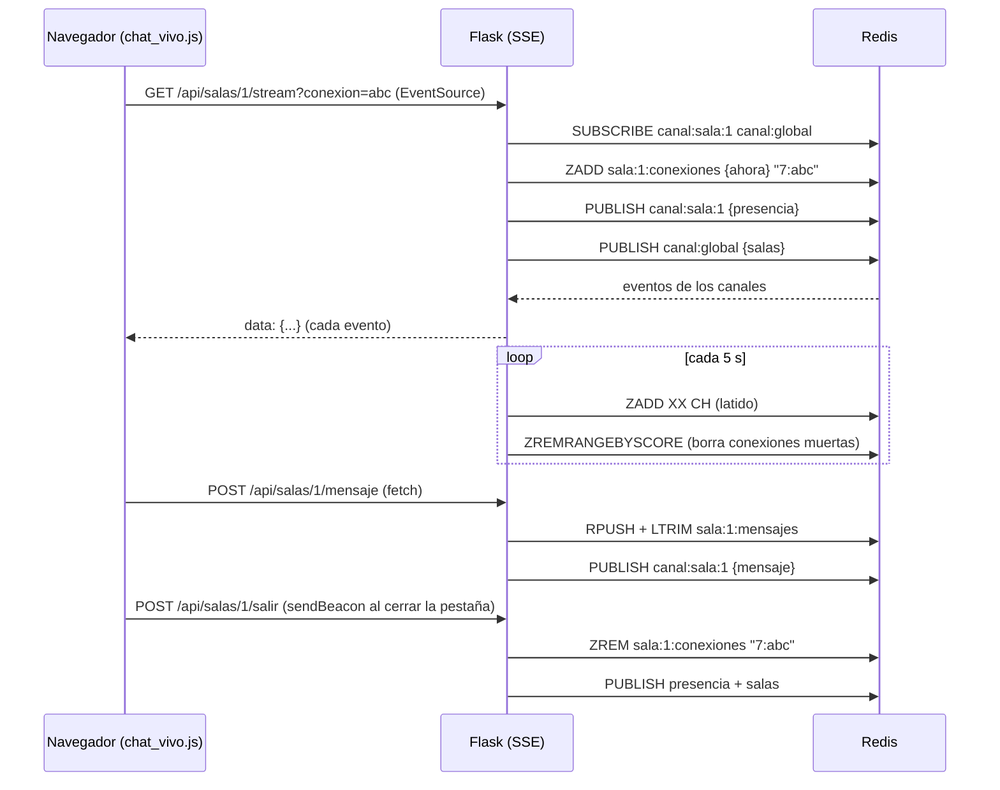

# Chat en vivo con Flask + Redis

Aplicacion de chat en tiempo real con **salas**, **usuarios registrados / invitados** y **lista de conectados en vivo**.
Solo usa **Flask** (servidor web + Server-Sent Events) y **Redis** (datos + Pub/Sub). No usa WebSockets ni librerias extra.

---

## 1. Requisitos

| Herramienta | Uso |
|---|---|
| Python 3.10+ | Ejecutar Flask |
| Redis **3.0.2 o superior** | Base de datos y Pub/Sub (Docker, WSL2 o instalador MSI de Windows) |
| `Flask`, `redis` | Unicas dependencias (`requirements.txt`) |

> [!NOTE]
> A la aplicacion no le importa **como** esta instalado Redis: solo necesita poder conectarse a
> `REDIS_HOST:REDIS_PORT` (por defecto `127.0.0.1:6379`). Elige **una sola** de las opciones de abajo.
> El comando mas nuevo que usa la app es `ZADD ... XX CH` (latido de presencia), disponible desde Redis 3.0.2.

## 2. Instalar y levantar Redis (elige una opcion)

### Opcion A - Docker

```powershell
# Primera vez: crea el contenedor
docker run -d --name redis -p 127.0.0.1:6379:6379 redis

# Siguientes veces (por ej. despues de reiniciar la PC)
docker start redis

# Comprobar que responde (debe mostrar PONG)
docker exec redis redis-cli PING
```

- Los datos se mantienen con `docker stop` / `docker start`, pero **se pierden si borras el contenedor** (`docker rm`).
- Si quieres que los datos sobrevivan aunque borres el contenedor, crealo con un volumen:

  ```powershell
  docker run -d --name redis -p 127.0.0.1:6379:6379 -v redis-datos:/data redis redis-server --appendonly yes
  ```

### Opcion B - WSL2 (Ubuntu dentro de Windows)

```powershell
# Primera vez: instalar Redis dentro de Ubuntu
wsl sudo apt update
wsl sudo apt install -y redis-server

# Cada vez que vayas a usar la app (WSL apaga Ubuntu cuando no se usa)
wsl sudo service redis-server start

# Comprobar que responde (debe mostrar PONG)
wsl redis-cli PING
```

- WSL2 reenvia `localhost` hacia Windows, asi que normalmente funciona con `REDIS_HOST=127.0.0.1` sin cambiar nada.
- **Si la app no logra conectarse:**
  1. Obtén la IP de Ubuntu con `wsl hostname -I` y ponla en `REDIS_HOST` del `.env`.
  2. En `/etc/redis/redis.conf` cambia `bind 127.0.0.1 ::1` por `bind 0.0.0.0` y define una contrasena con
     `requirepass tu_clave` (ponla tambien en `REDIS_PASSWORD` del `.env`).
  3. Reinicia: `wsl sudo service redis-server restart`.
- Los datos se guardan en disco por defecto (archivo `/var/lib/redis/dump.rdb`).

### Opcion C - Instalador MSI de Windows (versiones antiguas)

Redis no tiene version oficial para Windows, pero existen dos instaladores `.msi` no oficiales y ambos sirven:

| Instalador | Version de Redis | ¿Funciona? |
|---|---|---|
| Microsoft Open Tech (`microsoftarchive/redis`) | 3.0.504 (2016, abandonado) | Si |
| tporadowski (`tporadowski/redis`) | 5.0.14.1 | Si (recomendado entre los dos) |

```powershell
# El MSI instala Redis como servicio de Windows en el puerto 6379 y arranca solo con la PC.
# Comprobar que el servicio esta corriendo
Get-Service Redis

# Iniciarlo si esta detenido (PowerShell como administrador)
Start-Service Redis

# Comprobar que responde (debe mostrar PONG)
& "C:\Program Files\Redis\redis-cli.exe" PING
```

- Con el `.env` por defecto funciona sin cambios.
- Los datos se guardan en disco por defecto (archivo `dump.rdb` en la carpeta de instalacion).
- Al conectarse, la libreria `redis-py` envia el comando `CLIENT SETINFO`, que estas versiones antiguas no conocen;
  la libreria ignora ese error y sigue normalmente.

> [!WARNING]
> **No tengas dos Redis usando el puerto 6379 al mismo tiempo** (por ejemplo, el servicio MSI y el contenedor de Docker).
> La app se conectaria a cualquiera de los dos y parecera que "se pierden" los datos. Deten los que no uses
> (`docker stop redis`, `Stop-Service Redis` o `wsl sudo service redis-server stop`) o cambia `REDIS_PORT`.

## 3. Instalar y ejecutar la aplicacion

```powershell
# 1. Entorno virtual + dependencias
python -m venv .venv
.\.venv\Scripts\activate
pip install -r requirements.txt

# 2. Variables de entorno
Copy-Item .env.example .env      # luego edita .env si hace falta

# 3. Ejecutar (Redis debe estar levantado antes)
python app.py
```

Abrir **http://127.0.0.1:5000**

Si aparece el error `No se pudo conectar a Redis`, revisa que Redis responda `PONG` (ver la opcion que elegiste)
y que `REDIS_HOST`, `REDIS_PORT` y `REDIS_PASSWORD` del `.env` sean correctos.

> [!IMPORTANT]
> Para probar con **varios usuarios a la vez** usa **navegadores distintos** o una ventana **incognito**.
> Las pestañas del mismo navegador comparten la cookie de sesion de Flask, asi que si inicias sesion
> con otro usuario en una pestaña nueva, **todas** las pestañas pasan a ser ese usuario.

## 4. Variables de entorno (`.env`)

El archivo `.env` se lee con un lector propio en [config.py](config.py) (solo libreria estandar, sin `python-dotenv`).
Las variables reales del sistema tienen prioridad sobre las del `.env`.

| Variable | Defecto | Descripcion |
|---|---|---|
| `SECRET_KEY` | `clave-secreta-redis` | Firma la cookie de sesion de Flask. **Cambiala.** |
| `FLASK_HOST` | `127.0.0.1` | Interfaz donde escucha Flask (`0.0.0.0` para la red local) |
| `FLASK_PORT` | `5000` | Puerto web |
| `FLASK_DEBUG` | `1` | `1` = recarga automatica y errores detallados |
| `REDIS_HOST` | `127.0.0.1` | Host de Redis |
| `REDIS_PORT` | `6379` | Puerto de Redis |
| `REDIS_DB` | `0` | Numero de base de datos de Redis |
| `REDIS_PASSWORD` | *(vacio)* | Contrasena de Redis, vacio = sin contrasena |
| `MAX_MENSAJES_HISTORIAL` | `100` | Mensajes maximos guardados por sala (`LTRIM`) |
| `MENSAJES_POR_PAGINA` | `50` | Mensajes mostrados al abrir una sala (`LRANGE`) |
| `INTERVALO_LATIDO_SEGUNDOS` | `5` | Cada cuanto una conexion abierta renueva su latido |
| `PRESENCIA_TTL_SEGUNDOS` | `15` | Tiempo sin latido para considerar muerta una conexion |

## 5. Arquitectura en 3 capas

```
chat_en_vivo/
├── app.py                       # Punto de entrada + inyeccion de dependencias
├── config.py                    # Configuracion + lector del .env
├── .env / .env.example          # Variables de entorno
├── presentacion/                # CAPA 1 - Flask (rutas, HTML, JS)
│   ├── rutas/auth.py            #   login, registro, invitado, logout
│   ├── rutas/chat.py            #   vista del chat, API de mensajes, stream SSE
│   ├── rutas/decoradores.py     #   @login_requerido
│   ├── templates/               #   login.html, chat.html
│   └── static/js/chat_vivo.js   #   EventSource + fetch + sendBeacon
├── negocio/                     # CAPA 2 - Reglas de negocio
│   ├── servicio_autenticacion.py
│   ├── servicio_sala.py         #   salas + contadores en vivo
│   └── servicio_chat.py         #   mensajes + presencia + streaming
└── datos/                       # CAPA 3 - Acceso a Redis
    ├── gestor_redis.py          #   Pool de conexiones unico
    ├── contratos/               #   Interfaces (ABC)
    └── repositorios/            #   Implementaciones con Redis
```

Cada capa solo conoce a la de abajo. Los servicios dependen de las **interfaces** (`datos/contratos`), no de Redis directamente.

## 6. Claves de Redis

| Clave | Tipo | Contenido |
|---|---|---|
| `id:usuario` | String | Secuencia de IDs de usuario (`INCR`) |
| `usuario:{id}` | Hash | `id, nombre, password_hash, fecha_registro, es_invitado` |
| `indice:usuario:nombre` | Hash | nombre en minusculas → id (unicidad con `HSETNX`) |
| `usuarios` | Set | IDs de usuarios existentes |
| `contador:usuarios` | String | Total de usuarios |
| `id:sala` | String | Secuencia de IDs de sala |
| `sala:{id}` | Hash | `id, nombre, descripcion, creador_id` |
| `indice:sala:nombre` | Hash | nombre en minusculas → id |
| `salas` | Set | IDs de todas las salas |
| `sala:{id}:conexiones` | **Sorted Set** | miembro `"{usuario_id}:{conexion_id}"`, score = hora del ultimo latido |
| `id:mensaje` | String | Secuencia de IDs de mensaje |
| `sala:{id}:mensajes` | List | Mensajes en JSON (`RPUSH` + `LTRIM`) |
| `contador:mensajes` | String | Total historico de mensajes |

### Canales Pub/Sub

| Canal | Quien lo escucha | Eventos |
|---|---|---|
| `canal:sala:{id}` | Los conectados a esa sala | `mensaje`, `presencia` |
| `canal:global` | Todos los conectados | `salas` (contador de conectados de cada sala, salas nuevas) |

## 7. Como funciona el tiempo real



### Por que la presencia usa un Sorted Set de conexiones

Antes la presencia era un `Set` con IDs de usuario (`sala:{id}:online`) y tenia 3 problemas:

1. **Nombres fantasma**: si Flask se reiniciaba (pasa en cada guardado con `debug=True`) el bloque `finally`
   del stream nunca se ejecutaba y el usuario quedaba "online" para siempre.
2. **Varias pestañas**: al cerrar una de dos pestañas se borraba al usuario aunque siguiera en la otra.
3. **Lentitud al salir**: se dependia solo de que Flask detectara que el socket se cerro.

Ahora:

- Cada pestaña es una **conexion** con un ID unico (`conexion_id`), guardada con la hora de su ultimo latido.
- Las conexiones sin latido en `PRESENCIA_TTL_SEGUNDOS` se borran solas (`ZREMRANGEBYSCORE`) y se avisa a todos.
- Al cerrar o cambiar de pestaña, el navegador avisa con `navigator.sendBeacon` → salida inmediata.
- Al cerrar sesion se borran todas las conexiones del usuario en todas las salas.
- Los usuarios online se cuentan sin repetir (varias pestañas = 1 persona).

> [!NOTE]
> La clave antigua `sala:{id}:online` ya no se usa. Si existe en tu Redis puedes borrarla con
> `redis-cli DEL sala:1:online sala:2:online sala:3:online`, anteponiendo segun tu instalacion
> `docker exec redis` (Docker), `wsl` (WSL2) o usando `C:\Program Files\Redis\redis-cli.exe` (MSI).

## 8. Rutas

| Metodo | Ruta | Descripcion |
|---|---|---|
| GET | `/` | Pagina de acceso |
| POST | `/login` · `/registro` · `/invitado` | Autenticacion |
| POST | `/logout` | Cierra sesion (borra al invitado y su presencia) |
| GET | `/chat` · `/chat/<sala_id>` | Vista del chat |
| POST | `/salas/crear` | Crea una sala |
| POST | `/api/salas/<id>/mensaje` | Envia un mensaje (JSON `{"contenido": "..."}`) |
| POST | `/api/salas/<id>/salir?conexion=` | Salida explicita (sendBeacon) |
| GET | `/api/salas/<id>/stream?conexion=` | Stream SSE en vivo |

## 9. Registro de correcciones

| Problema | Causa | Correccion |
|---|---|---|
| No se podian enviar mensajes | La ruta `/api/salas/<id>/mensaje` no tenia `methods=["POST"]` → Flask respondia **405** | Se agrego `methods=["POST"]` |
| Iniciar sesion con cuenta registrada daba error 500 | `iniciar_sesion()` devolvia `None` en vez del usuario | Devuelve el perfil del usuario |
| Crear sala con nombre repetido daba error 500 | Se llamaba `flask(...)` en vez de `flash(...)` | Corregido + alertas visibles en `chat.html` |
| Nombres que seguian apareciendo al salir | `Set` sin vencimiento + `finally` que no corre si Flask se reinicia | Presencia por conexion con latido (Sorted Set) + `sendBeacon` + limpieza en logout |
| Numeros de las salas no se actualizaban | Solo se publicaba en el canal de la sala actual | Nuevo `canal:global` con el contador de todas las salas |
| Salas nuevas no aparecian a los demas | Igual que el anterior | La sala nueva llega por `canal:global` y el JS la agrega |
| Fechas de registro guardadas como `Y-10-18 ...` | Faltaba `%` en `strftime("%Y-...")` | Corregido |
| `import app` dentro de `app.py` | El modulo se importaba a si mismo | Eliminado |
| Nombre del canal distinto a la documentacion | `canal:{id}` vs `canal:sala:{id}` | Unificado a `canal:sala:{id}` |
| Errores de API devolvian HTML de login | `@login_requerido` redirigia siempre | Las rutas `/api/` responden JSON 401 |
